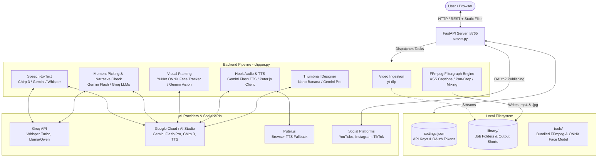
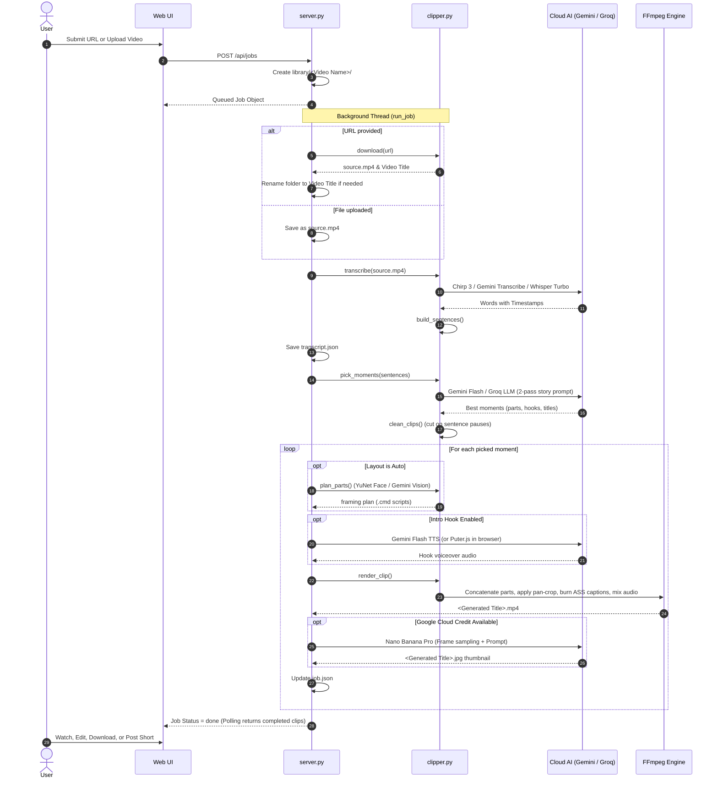
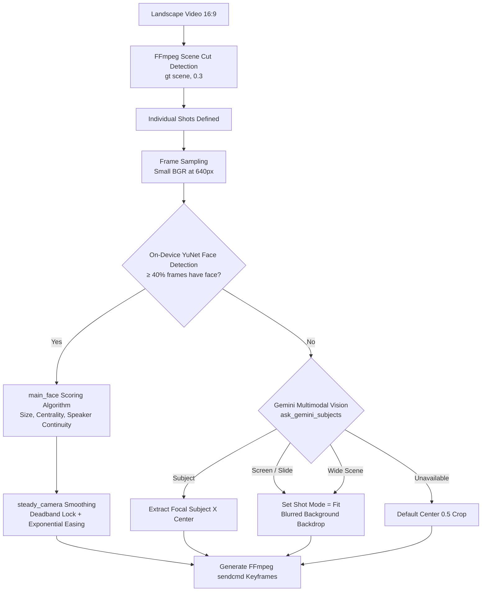
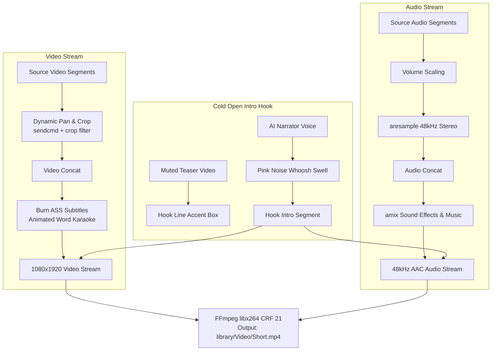
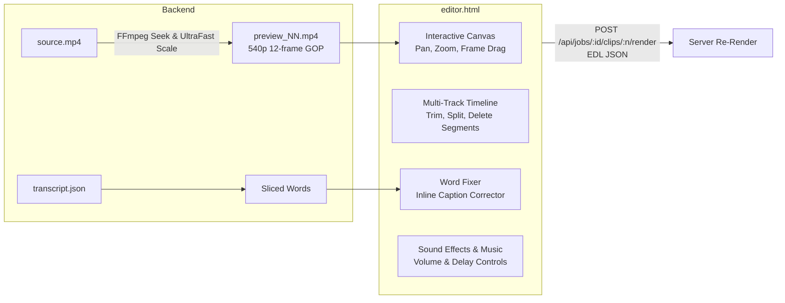

# Tiny Clipper Architecture & System Design

Tiny Clipper is a local-first, GPU-independent automated pipeline and web workstation that converts long-form landscape videos into viral, captioned 9:16 vertical shorts (TikTok, YouTube Shorts, Instagram Reels).

It relies entirely on lightweight local processing (CPU OpenCV face detection, FFmpeg) combined with tiered cloud AI APIs (Google Gemini, Groq Whisper/LLM, Cloud Speech-to-Text Chirp 3), allowing it to run smoothly on standard consumer computers without requiring a dedicated graphics card.

---

## 1. High-Level Architecture

The system consists of a single-process FastAPI backend driving an asynchronous worker thread pool, a responsive Vanilla JS browser UI, and FFmpeg for video rendering.



---

## 2. Core Components

### 2.1 Backend Application Server (`server.py`)
- **Framework:** FastAPI running under Uvicorn, bound strictly to `127.0.0.1:8765` for security.
- **Task Management:**
  - `worker = ThreadPoolExecutor(max_workers=1)`: One video processed at a time to prevent concurrent API rate-limiting on free tiers.
  - `poster = ThreadPoolExecutor(max_workers=2)`: Background publisher for social media uploads.
- **Thread Safety:** `threading.RLock()` coordinates reads/writes to `job.json` to prevent file-lock collision on Windows.
- **Folder Organization:** Automatically maintains `library/<Video Name>/` named directories containing `<Short Title>.mp4` and matching `<Short Title>.jpg` thumbnails.
- **Static Mounting:** Mounts `/library` directly to `StaticFiles` for instantaneous streaming of proxies, shorts, and thumbnails.

### 2.2 Processing & Rendering Engine (`clipper.py`)
- **FFmpeg Abstraction:** Automatically detects system FFmpeg or extracts the bundled binary from `imageio-ffmpeg` into `tools/ffmpeg.exe`.
- **Sanitization:** `safe_filename` enforces cross-platform safety (stripping illegal Windows characters, colons, pipes, and reserved names).
- **Subtitles:** Compiles word-level timestamps into Advanced SubStation Alpha (`.ass`) with dynamic font scaling and gold highlight styling.

### 2.3 Social Distribution Engine (`social.py`)
- **Instagram Graph API:** Generates temporary 1-hour hosting URLs via Litterbox for Instagram's video ingestion crawler, uploads video containers, and publishes Reels.
- **YouTube Data API v3:** Performs chunked resumable uploads of vertical video files marked as Shorts.
- **TikTok API:** Dispatches videos directly to creator inboxes as drafts.

### 2.4 Web Frontends (`web/index.html` and `web/editor.html`)
- **Vanilla Architecture:** Zero client-side dependencies (no React or bundler required).
- **Main Dashboard (`web/index.html`):** Live job tracking, API key modal, platform connection, and video shelf.
- **Timeline Editor (`web/editor.html`):** Multi-track timeline, keyframe scrubbing, visual pan-and-crop canvas, audio mixer, and word-level caption editing.

---

## 3. End-to-End Processing Pipeline



---

## 4. How Moments Are Picked & Evaluated (Metrics & Criteria)

Moment selection is not a simple volume-threshold or random chunking algorithm. It is driven by an AI editorial model running a **two-pass evaluation** against punctuated sentence transcripts (`pick_moments`).

### 4.1 Narrative Structure Metrics
Every candidate short must satisfy a complete 4-part micro-narrative:
1. **Hook:** Why should the viewer stop scrolling? (Must open with a provocative question, bold claim, or high-stakes premise; never introductory filler like *"So today..."* or *"And then..."*).
2. **Setup:** The immediate context a newcomer needs without having watched the rest of the video.
3. **Development:** The core substance — reasons, real-life examples, turning points, or technical explanations.
4. **Payoff:** A definitive conclusion, moral, punchline, or clear takeaway.

### 4.2 Editorial Rules & Filtering Heuristics
The prompt explicitly penalizes and discards:
- Housekeeping and channel banter (*"Subscribe to my channel"*, *"Click the link below"*, *"Next question"*).
- Speech dysfluencies (stuttering, false starts, rambling).
- Self-referential cutouts pointing to missing context (*"As I mentioned earlier"*, *"Look at that thing"* without visual clarity).
- Non-substantive quips that require artificial padding to meet time limits.

### 4.3 Multi-Part Stitching Logic
If a single continuous stretch conveys the entire idea, the pipeline uses 1 continuous part. If the speaker goes on tangents, the AI is allowed to join up to **`MAX_PARTS = 3` non-contiguous sentence runs**:
- Tangents, filler, and repetitive thoughts are omitted.
- Parts play in the listed order unless a later sentence serves as a dramatically superior cold open.
- Overlap prevention: two clips from the same source video are strictly prohibited from sharing any of the same sentences.

### 4.4 Duration Constraints
- **Target Duration:** `MIN_CLIP = 40` seconds to `MAX_CLIP = 75` seconds.
- **Acceptable Bounds:** `KEEP_MIN = 10` seconds hard floor, `KEEP_MAX = 90` seconds hard ceiling. If a candidate subject cannot sustain 40 seconds of substance, it is discarded rather than padded with fluff.

### 4.5 The Two-Pass Review Process
1. **Pass 1 (Discovery - `PROMPT`):** Generates candidate clips with a viral potential score (0–100), titles, hook descriptions, sentence runs (`parts`), teaser sentence ID, and hook voiceover text.
2. **Pass 2 (Verification - `REVIEW_PROMPT`):** Evaluates each draft from the perspective of a **first-time viewer**. The model checks whether the setup or payoff was cut off, whether any sentence refers to deleted context, and dynamically extends or trims sentence runs to guarantee self-contained story completion.

### 4.6 Boundary Snapping & Silence Buffers (`run_span`)
Cuts are strictly snapped to sentence boundaries and natural pauses:
$$\text{Start Time} = \max\left(s_a - 0.25,\; \frac{e_{a-1} + s_a}{2},\; 0.0\right)$$
$$\text{End Time} = \min\left(e_b + \delta,\; \frac{e_b + s_{b+1}}{2},\; \text{duration}\right)$$
Where $\delta = 0.7\text{s}$ at the final clip exit (allowing natural vocal decay) and $\delta = 0.3\text{s}$ at intermediate part joins. This guarantees no clipped consonants or unnatural abruptness.

### 4.7 Visual-First & Silent/Action Moment Picking (`pick_visual_moments`)
For videos with no audio, minimal speech (< 5 words), or non-verbal content (gaming montages, workout routines, sports highlights, silent tutorials, b-roll), Tiny Clipper automatically switches to a visual-first pipeline:
1. **Local Energy Pre-Filtering (`scan_motion_energy`):** A fast 2 FPS low-resolution (160×90) scan calculates inter-frame absolute differences via OpenCV to measure movement intensity across time.
2. **Scene Cut Density:** Hard visual transitions are detected via FFmpeg's `select='gt(scene,0.3)'`. Windows with dense scene cuts or high motion receive priority scoring.
3. **Sliding Window Selection (`find_visual_windows`):** Candidate windows of 45s (stepped every 10s) are scored and non-maximum suppressed (maximum 40% overlap).
4. **Shot Boundary Snapping:** The start and end of each visual candidate are snapped to the nearest scene cut within $\pm 5\text{s}$, preventing cuts in the middle of a continuous action shot.
5. **Multimodal Hook Scoring (`ask_gemini_visual_moments`):** Representative keyframes from each candidate window are evaluated by Gemini Vision, which generates a viral title, a 3-second curiosity gap hook line (e.g., *"Wait until the very end"*), and a visual action score. If offline or without API keys, local motion ranking is used directly.
6. **Caption-Free & Silent Rendering:** Subtitle burning is cleanly bypassed (`captions: false`), the curiosity gap question is burned into the top-third intro badge, and if the source has no audio track, a standardized silent stereo audio bed (`anullsrc`) is generated to ensure full platform compatibility.

---

## 5. How the Subject Is Picked Up & Framed (Framing Engine)

Converting 16:9 landscape video into 9:16 vertical video requires finding and tracking the focal point across every scene cut without introducing shaky, seasick camera movements.



### 5.1 Shot Segmentation
FFmpeg analyzes the video stream using the filter `select='gt(scene,0.3)'`. Any scene change above the 30% visual variance threshold marks a new shot boundary. Cuts closer than 1.0 second apart are merged to ignore lightning or strobe flicker.

### 5.2 Local Face Detection: YuNet ONNX (`face_detector`)
- Model: `face_detection_yunet_2023mar.onnx` (~230 KB), automatically cached to `tools/`.
- Runs on CPU via OpenCV's `cv2.FaceDetectorYN` with a confidence threshold of `0.7`.
- Downsampled frames are processed at `SAMPLE_FPS = 4` to minimize CPU load while maintaining tracking fidelity.

### 5.3 Speaker Selection Metric (`main_face`)
When multiple people appear in the shot (interviews, podcasts, crowds), the engine scores each face to determine who the camera should track:
$$\text{Score} = w \times h \times \left(1 - 0.5 \times |cx - 0.5|\right)$$
1. **Background Face Suppression:** Any face with $w < 0.04 \times \text{frame\_width}$ is discarded as audience or background clutter.
2. **Size & Centrality:** Larger faces receive higher weighting; faces closer to the center ($cx \approx 0.5$) are favored over edge faces.
3. **Speaker Continuity Bonus:** If a candidate face is near the previously tracked speaker ($|cx - \text{previous}| < 0.1$), its score is multiplied by **$1.6\times$**. This prevents distracting camera oscillations back and forth between two people sitting near each other.

### 5.4 Gemini Multimodal Vision Fallback (`ask_gemini_subjects`)
If faces are present in fewer than 40% of a shot's frames (e.g. food preparation, software demos, unboxings, animal videos, sports), the middle frame of each faceless shot is encoded to JPEG and submitted to `gemini-3.8-flash` / `gemini-3.5-flash`:
- `"subject"`: The model identifies the primary object or animal and returns its normalized horizontal center `x` ($0.0 \le x \le 1.0$).
- `"screen"`: Identified as slides, IDEs, spreadsheets, or documents where cropping text would ruin readability.
- `"wide"`: Panoramic shots where the entire composition matters.

### 5.5 Camera Smoothing (`steady_camera`)
Raw face detections produce jittery motion. The pipeline applies a stabilizing filter:
- **Deadband Lock:** Movements of less than 4% ($|x - cam| \le 0.04$) are ignored, locking the camera in place during micro-movements.
- **Exponential Easing:** When real motion occurs, the camera eases smoothly toward the subject:
  $$cam \leftarrow cam + (x - cam) \times 0.35$$

### 5.6 Crop Coordinate Math (`crop_x`)
For video scaled to height 1920 (width $\text{scaled\_w} = \text{round}(\text{width} \times 1920 / \text{height})$):
$$x_{\text{pixel}} = \text{clamp}\left(0,\; \text{round}(x \times \text{scaled\_w} - 540),\; \text{scaled\_w} - 1080\right)$$
The crop window (1080px wide) is clamped to prevent revealing empty canvas past the left or right video edges. Keyframe instructions are written to a `.cmd` text file and ingested by FFmpeg's `sendcmd` filter at 15 evaluations per second.

---

## 6. How Clips Are Physically Created (Rendering & Composition)

The rendering engine (`render_edit`) translates AI instructions, framing coordinates, subtitle scripts, and audio assets into an optimized vertical short.



### 6.1 The Cold Open Hook
If enabled, the clip begins with a high-retention teaser before the main story starts:
1. **Teaser Span:** Plays the clip's peak moment (defined by `teaser_id`) muted for 3–5 seconds.
2. **Hook Box Overlay (`build_hook_ass`):** Displays a high-contrast title in white font over an accent badge (BGR `#FF5A36` coral) with fade-in/fade-out timing.
3. **Narrator Audio:** Mixes the AI TTS voice with a 150ms delay (`adelay=150:all=1,volume=1.4,apad`).
4. **Whoosh Sound Synthesis:** Generates a synthetic whoosh directly via FFmpeg's `lavfi`:
   - Filter: `anoisesrc=r=48000:c=pink:a=0.5`
   - EQ & Dynamics: `highpass=f=300,lowpass=f=7000,afade=t=in:d=0.45:curve=exp,afade=t=out:st=0.45:d=0.15,volume=2.0`
   - The whoosh swells precisely into the cut point, signaling the start of the main clip.

### 6.2 Animated Karaoke Captions (`build_edit_ass`)
- **Word Chunking:** Subtitles are grouped into punchy bursts of at most 3 words, breaking on commas, periods, or pauses exceeding 0.6s (`caption_groups`).
- **Visual Styling:** Large Arial bold font (86pt), opaque black outline (7pt), subtle drop shadow, positioned in the lower-middle safe area ($y \approx 71\%$).
- **Active Word Highlighting & Kinetic Pop:** The currently spoken word dynamically scales to 112% and lights up in gold (`{\fscx112\fscy112\c&H00D7FF&}`), creating a punchy word-pop effect before returning to standard white font (`{\fscx100\fscy100\c&HFFFFFF&}`).

### 6.3 Dual-Layout Composition (Auto Mode)
For segments categorized as `fit` (screen recordings, slides, wide shots):
- The original video is letterboxed in full without cropping.
- The background is filled with an enlarged, blurred copy of the same video (`fit_chain`). To minimize CPU overhead, the background layer is first downsampled (`scale=270:480`), blurred using `boxblur=8:2`, and scaled back up to 1080×1920 with bilinear filtering, achieving ~5× faster rendering.
- FFmpeg's `overlay=enable='between(t, s, e)'` toggles between face-tracked crop and full-frame fit seamlessly mid-clip.

### 6.4 Audio Normalization, Ducking & Mixing
- All audio inputs are resampled to a standardized format: `aresample=48000,aformat=channel_layouts=stereo`.
- **Automatic Audio Ducking:** Background music or ambient audio tracks (duration $\ge$ 5s) are automatically ducked under the speaker's voice track via FFmpeg's `sidechaincompress=threshold=0.10:ratio=4:attack=50:release=450`. When speech pauses, the music volume smoothly returns to 100%. Ducking can be toggled per track in the timeline editor.
- Short sound effects (whoosh, pop, ding, boom, click) are mixed at their full configured volume without ducking.

### 6.5 Hardware-Accelerated Video Encoding
- When rendering with FFmpeg, Tiny Clipper auto-detects hardware H.264 video encoders (`h264_nvenc` for NVIDIA, `h264_qsv` for Intel QuickSync, `h264_videotoolbox` on macOS, and `h264_mf` via Windows MediaFoundation).
- If no supported GPU hardware is available or if hardware encoding returns an error, it seamlessly falls back to CPU `libx264` (`-preset veryfast -crf 21`). Software encoding can also be forced by setting `CLIPPER_FORCE_CPU=1`.

---

## 7. Storage & File Organization

The project uses a transparent, human-readable file storage pattern. Jobs and clips are stored as standard folders and files that users can explore in Windows Explorer:

```
library/
└── <Sanitized Video Name>/
    ├── <Generated Clip Title 1>.mp4    # Rendered 9:16 Short
    ├── <Generated Clip Title 1>.jpg    # 9:16 AI Thumbnail
    ├── <Generated Clip Title 2>.mp4
    ├── <Generated Clip Title 2>.jpg
    ├── clip_01.ass                     # Styled Subtitle File
    ├── clip_01_hook.ass                # Teaser Overlay Subtitles
    ├── clip_01_p0.cmd                  # Dynamic FFmpeg Crop Commands
    ├── voice_01.clean.wav              # Hook Voiceover Audio
    ├── source.mp4                      # Original Source Video
    ├── transcript.json                 # Words, Timestamps, Segments
    └── job.json                        # Metadata State Machine
```

### `job.json` Structure
```json
{
  "id": "I Tried EVERY Way To Build Muscle",
  "name": "I Tried EVERY Way To Build Muscle",
  "status": "done",
  "step": "done",
  "duration": 2480,
  "language": "en",
  "clips": [
    {
      "i": 1,
      "title": "The Greatest Muscle Building Supplement Is Free",
      "file": "The Greatest Muscle Building Supplement Is Free.mp4",
      "thumb": "The Greatest Muscle Building Supplement Is Free.jpg",
      "score": 94,
      "length": 26,
      "framing": "follows the face, follows the subject",
      "parts": [{"s": 2345.94, "e": 2356.73}, {"s": 2378.78, "e": 2388.98}]
    }
  ]
}
```

---

## 8. Interactive Clip Editor Architecture

When a user clicks **Edit** on any short, the editor opens (`web/editor.html`):



1. **Fast Proxy Generation:** An ultrafast 540p preview proxy (`preview_NN.mp4`) with a keyframe every 12 frames is cut around the clip's time window, allowing instant scrubbing in the browser without lag.
2. **Edit Decision List (EDL):** The client edits a JSON structure containing segments, frame coordinates, text overlays, and sound tracks.
3. **Word Fixes:** Correcting a misspelled word updates `transcript.json` and burns directly into the newly rendered ASS subtitles upon export.

---

## 9. Model Cascade & Resiliency Matrix

Tiny Clipper handles API errors, quotas (429), server overloads (503), and decommissioned models (404) by automatically cascading:

| Task | Primary Tier | Secondary Tier | Tertiary Tier |
| :--- | :--- | :--- | :--- |
| **Speech-to-Text** | Google Cloud Chirp 3 | `gemini-3.5-transcribe` | Groq `whisper-large-v3-turbo` |
| **Moment Picking** | `gemini-3.1-flash-lite` | `gemini-3.5-flash-lite` / `latest` | Groq `openai/gpt-oss-120b` / `qwen3.8-27b` |
| **Subject Detection**| OpenCV YuNet ONNX | `gemini-3.8-flash` Vision | Fallback to Center 9:16 Crop |
| **Hook Narration** | `gemini-3.8-flash-tts` | `gemini-3.8-flash-lite-tts` | Browser Puter.js Client |
| **Thumbnails** | `gemini-3-pro-image` | `gemini-nano-banana-2.1` | First frame fallback |
